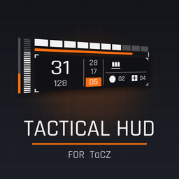
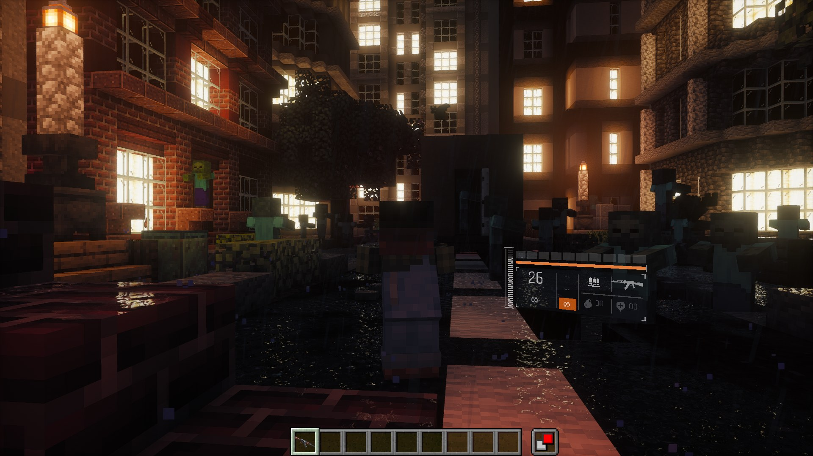
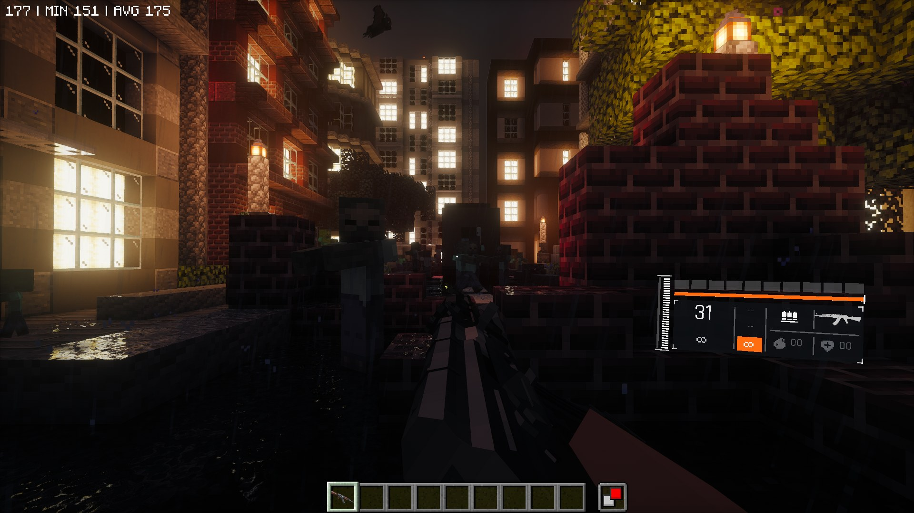

<p align="center"></p>

# TaCZ Tactical HUD

[English](README.md) · **Русский**

Наклонный перспективный 3D-HUD оружия для мода **[TaCZ] Timeless and Classics Zero** (Minecraft 1.20.1, Forge), вдохновлённый интерфейсом *Tom Clancy's The Division*.

Панель висит рядом с персонажем, повёрнута в пространстве и показывает всё, что нужно в бою: патроны, запас, броню, здоровье, режим огня, перезарядку, перегрев, гранаты и аптечки.

> Версия: **0.1.0-alpha** · Minecraft **1.20.1** · Forge **47.x** · TaCZ **1.1.8+** · только клиент
>
> Не связан с Ubisoft и командой TaCZ и не одобрен ими.





## Возможности

- **Настоящий 3D**: панель рисуется в перспективной проекции, поэтому один край ближе, другой дальше, как у агента SHD.
- **Отдельные раскладки для первого и третьего лица**: позиция, масштаб, углы, перспектива, инерция и прозрачность у каждого вида свои. При нажатии F5 панель плавно перетекает из одной раскладки в другую.
- **Живая анимация**: инерция при поворотах камеры, тряска при уроне, «призрачная» полоса здоровья, вспышка при выстреле, анимация появления и пульсация предупреждений.
- **Всё в одном месте**: патроны в магазине и в стволе, запас, запасные магазины, патроны других стволов в хотбаре, режим огня, перезарядка, перегрев, броня, здоровье, гранаты, аптечки.
- **Чистый экран по желанию**: можно скрыть ванильные сердца, броню, хотбар, опыт и еду, пока виден HUD.
- **Размер под любой экран**: `Авто` (по высоте экрана) или фиксированные `x1`–`x4`.
- **Настройка ползунками в игре** через Cloth Config (необязательная зависимость).
- **Совместимость с данными**: что считать гранатой или аптечкой, задаётся тегами предметов и расширяется датапаком.

## Быстрый старт

1. Установите Forge 47.x для Minecraft 1.20.1.
2. Положите в `mods/` jar-файлы TaCZ и `tacz_tactical_hud-1.20.1-0.1.0-alpha.jar`.
3. По желанию добавьте Cloth Config 11.x — тогда появится меню настроек.
4. Возьмите оружие TaCZ в руки. В третьем лице (F5) панель встанет у бедра персонажа.

Настройки: **Mods → TaCZ Tactical HUD → Config** или своя клавиша в **Управление → TaCZ Tactical HUD** (по умолчанию не назначена).

## Документация

| Файл | О чём |
|---|---|
| [docs/HOW_IT_WORKS.ru.md](docs/HOW_IT_WORKS.ru.md) | Что показывает каждый элемент и как устроены отрисовка, анимации и данные |
| [docs/USER_GUIDE.ru.md](docs/USER_GUIDE.ru.md) | Установка, все настройки, теги, частые вопросы, решение проблем |
| [docs/DEVELOPMENT.ru.md](docs/DEVELOPMENT.ru.md) | Сборка, запуск в IDE, структура кода, как добавлять элементы, выпуск версии |
| [CHANGELOG.md](CHANGELOG.md) | История версий |

## Сборка

```bash
# один раз: положить jar TaCZ в libs/ (см. docs/DEVELOPMENT.md)
./gradlew build
# результат: build/libs/tacz_tactical_hud-1.20.1-0.1.0-alpha.jar
```

## Лицензия

Код распространяется под **GPL-3.0** (см. [LICENSE](LICENSE)): часть логики подсчёта патронов перенесена из TaCZ, который тоже под GPL-3.0. Шрифт Rajdhani распространяется под SIL Open Font License 1.1 (см. [THIRD_PARTY_NOTICES.md](THIRD_PARTY_NOTICES.md)).
